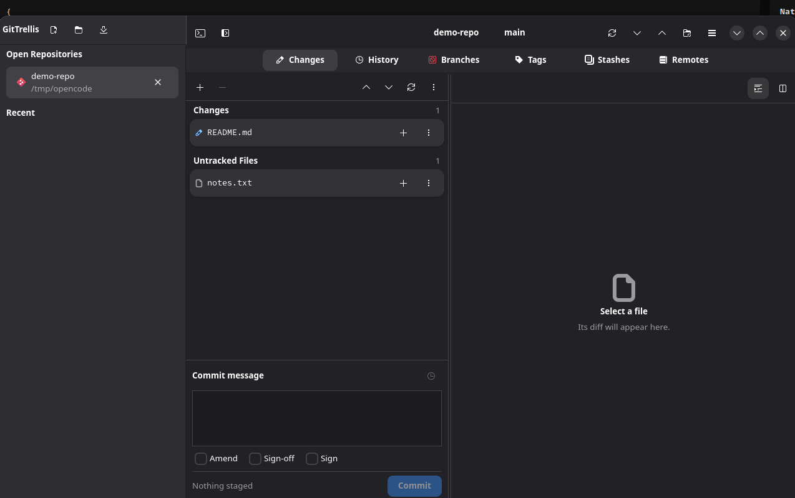
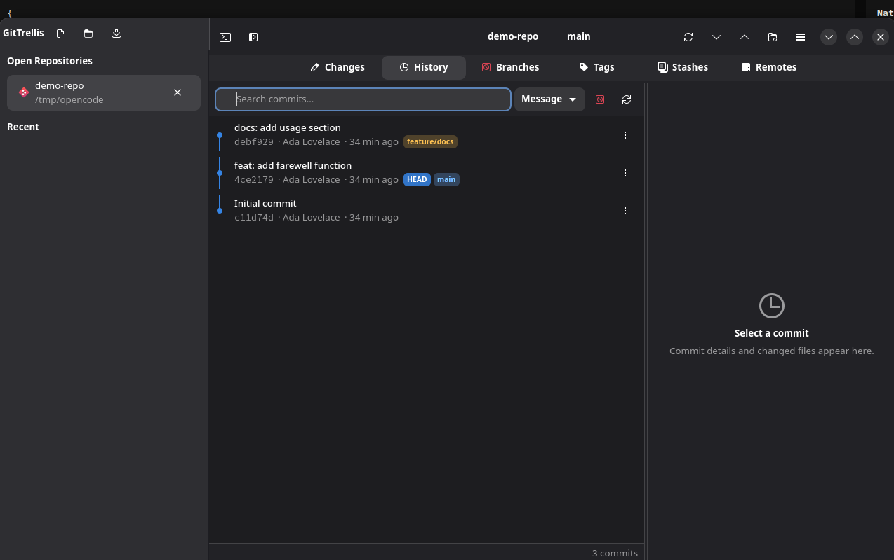

# GitTrellis — a native Git GUI client for Linux

> **Status: alpha (0.2.0).** Feature-complete for everyday work; expect rough edges.

GitTrellis is a desktop Git client built with Rust, GTK4 and libadwaita. It is
designed for Fedora (and Linux desktops generally) and aims to make everyday
Git work pleasant without hiding the details: you get a graphical commit
graph, hunk-level staging, side-by-side diffs, conflict resolution and
branch/tag/stash/remote management, while authentication and signing remain
exactly where your terminal left them — in Git itself.




## Features

- **Changes view** — staged, unstaged, untracked, ignored and conflicted
  files in separate groups, with stage/unstage, discard, delete-untracked and
  add-to-.gitignore actions.
- **Diff viewer** — unified and side-by-side layouts, line numbers, word-level
  highlighting in side-by-side mode, binary file indication, large-diff
  protection, and **hunk-level stage / unstage / discard**.
- **Commit workflow** — message and description, amend, sign-off, GPG/SSH
  signing (delegated to Git), recent-message history, and a guard against
  committing unstaged work.
- **History** — virtualised commit list with a drawn commit graph (branches,
  merges, tags, remote refs, HEAD), commit details, changed files, per-file
  diffs, and actions: copy SHA/message, create branch/tag, cherry-pick,
  revert, reset, checkout, compare with working tree.
- **Branches** — create, checkout, rename, delete (with safety confirmation),
  merge, rebase, set upstream, push, and compare branches.
- **Remotes** — add, edit, rename, remove, fetch (with optional prune), pull
  (merge / rebase / fast-forward-only), push (including safe force-with-lease
  and confirmed force), delete remote branches and push/delete tags.
- **Tags** — lightweight and annotated tags, checkout, push, and delete
  locally or on a remote.
- **Stashes** — create (optionally including untracked files and keeping the
  index), apply, apply-and-restore-index, pop, drop, create a branch from a
  stash, and view the stash diff.
- **One-click sync** — a context-aware header button shows `Pull N`,
  `Push N`, `Sync ↑N ↓M` or `Publish Branch` and performs the action
  immediately; Ctrl+P pushes and Ctrl+Shift+P pulls without dialogs when an
  upstream exists. Full dialogs (remote, refspec, force mode, rebase,
  fast-forward-only) remain available from the Remotes tab and the branch
  menu.
- **Native authentication prompts** — passphrase-protected SSH keys and
  HTTPS credentials are requested in a proper desktop dialog, so no terminal
  is required.
- **Conflicts** — first-class conflict view: conflicted files listed
  separately, per-region *Accept current / incoming / both*, side-by-side
  region display, mark-as-resolved, and continue/abort/skip for merges,
  rebases, cherry-picks and reverts.
- **Clone & init** — graphical clone with progress, cancellation and shallow
  options; initialize a repository from the GUI.
- **Multiple repositories** — sidebar with open and recent repositories,
  restored between sessions.
- **Search** — commit messages, authors, hashes and changed file names, plus
  filters for branches and tags.
- **Auto-refresh** — the changes view and branch state update every few
  seconds while the window is focused.
- **Editable shortcuts** — every command's keys can be changed, disabled or
  reset in Settings → Shortcuts (F1 shows the reference).
- **Git output console** — every operation's raw output is available at the
  bottom of the window, and a diagnostics log with copyable details is
  available from the menu.
- **Native integration** — Wayland and X11, system file dialogs, dark/light
  themes via libadwaita, high-DPI support, XDG config/state directories, and
  a full, editable keyboard shortcut set.

Default shortcuts (all editable in Settings):

| Shortcut | Action |
|---|---|
| `Ctrl+O` / `Ctrl+Shift+O` | Open / clone repository |
| `Ctrl+W` | Close repository |
| `Ctrl+R` | Refresh |
| `Ctrl+1` … `Ctrl+6` | Changes, History, Branches, Tags, Stashes, Remotes |
| `Ctrl+S` / `Ctrl+Shift+S` | Stage selected / stage all |
| `Ctrl+Enter` | Commit |
| `Ctrl+P` / `Ctrl+Shift+P` | Push / pull (one click) |
| `Ctrl+F` | Fetch (direct) |
| `Ctrl+Shift+F` | Search history |
| `Ctrl+,` | Settings |
| `Ctrl+?` or `F1` | Shortcut reference |
| `F9` | Toggle sidebar |

## Architecture in one paragraph

The application is split into three layers: a **Git service layer**
(`src/git/`) that is the only place where the `git` executable is invoked — it
returns structured Rust types and never leaks raw output to the UI; an
**application core** (`src/core/`) with settings, logging, snapshots and the
background task runner; and the **GTK UI** (`src/ui/`), which renders views and
dispatches requests. All Git work happens on worker threads; the UI never
blocks. See [docs/ARCHITECTURE.md](docs/ARCHITECTURE.md) for details.

## Requirements

- Fedora 39+ (or any distribution with the libraries below)
- Rust 1.85+ and Cargo (for development builds)
- GTK 4.12+ and libadwaita 1.4+ (runtime and development packages)
- Git 2.23+ (tested against 2.56)

```bash
sudo dnf install git gtk4-devel libadwaita-devel desktop-file-utils \
    libappstream-glib rust cargo
```

## Development setup

```bash
git clone <repository-url> gittrellis
cd Git_Client
cargo build            # debug build
cargo run /path/to/repo
```

## Build (release)

```bash
cargo build --release
./target/release/gittrellis
```

## Tests

```bash
cargo test
```

The suite contains:

- **Unit tests** for every Git output parser (status, log, branches, tags,
  remotes, stashes, diffs, name-status, conflicts, configuration) and for the
  commit graph layout.
- **Integration tests** (`tests/git_integration.rs`) that run the *real* `git`
  binary against temporary repositories: staging, commits, unusual file names
  (spaces, Unicode, leading dashes, tabs, quotes), diffs and renames, branch
  lifecycle, merge/rebase/cherry-pick/revert conflicts and resolution, reset
  modes, stash lifecycle, tags, remote management, clone, fetch/pull/push over
  the local file transport, configuration, and a full end-to-end workflow.

Tests never touch your personal Git configuration: they run with
`GIT_CONFIG_NOSYSTEM=1`, a private `HOME`, and per-repository user settings.

The UI itself is verified with the manual checklist in
[docs/MANUAL_TESTING.md](docs/MANUAL_TESTING.md), which mirrors the automated
workflow test.

## Installing on Fedora

### From RPM (recommended)

```bash
sudo dnf install rpm-build cargo rust gtk4-devel libadwaita-devel \
    desktop-file-utils libappstream-glib
./scripts/build-rpm.sh
sudo dnf install dist/rpmbuild/RPMS/x86_64/gittrellis-*.rpm
```

GitTrellis then appears in the application menu under *Development* and can open
a repository passed as an argument: `gittrellis ~/Projects/my-repo`.

### Flatpak

```bash
flatpak install flathub org.gnome.Sdk//47 org.freedesktop.Sdk.Extension.rust-stable//47
flatpak-builder --user --install --force-clean build-dir \
    flatpak/io.github.gittrellis.GitTrellis.yml
flatpak run io.github.gittrellis.GitTrellis
```

For fully offline Flatpak builds, generate `flatpak/cargo-sources.json` with
the Flatpak project's `flatpak-cargo-generator.py` and add it to the manifest
sources.

## Packaging notes

- The RPM spec is at `packaging/fedora/gittrellis.spec`.
- `scripts/make-source-tarball.sh` vendors all Rust dependencies so distro
  builds need no network access.
- Desktop entry, AppStream metadata and the scalable icon live in `data/`.
- Configuration is stored in `$XDG_CONFIG_HOME/gittrellis/settings.json`; logs in
  `$XDG_STATE_HOME/gittrellis/logs/`.

## How GitTrellis handles credentials

GitTrellis never implements its own credential storage. Fetch, pull and push run
through the system `git` binary, so:

- SSH keys and `ssh-agent` work as configured in `~/.ssh/config`;
- HTTPS credentials go through your configured credential helper;
- commit and tag signing use your `user.signingkey` / `gpg.format`;
- `known_hosts` verification is unchanged.

Because a GUI has no terminal, GitTrellis ships a small **askpass helper**
(`/usr/bin/gittrellis-askpass`). It is wired into `GIT_ASKPASS` and
`SSH_ASKPASS` (with `SSH_ASKPASS_REQUIRE=force`) so that:

- a key passphrase prompts a native dialog once — click **Continue** and the
  operation proceeds;
- GitHub/GitLab HTTPS username and password/token prompts use the same
  dialog;
- cancelling the dialog fails the Git operation cleanly instead of hanging.

**To avoid being asked on every operation**, load your key into the SSH agent
once per session:

```bash
ssh-add ~/.ssh/id_ed25519
```

After that the agent answers automatically. The askpass dialog shows this hint
whenever it detects a key passphrase prompt.

Secrets typed into the dialog are only written to the waiting `ssh`/`git`
process; they are never logged, stored or displayed again. The logging layer
additionally redacts URL userinfo and token-like patterns as defence in
depth.

## Known limitations

- **Interactive rebase** (reordering/rewording commits) is not implemented;
  `git rebase --interactive` can still be run in a terminal.
- **Submodules** are shown as modified entries but there is no dedicated
  submodule management UI.
- **Worktrees**, `git bisect`, and `git replace`/grafts have no dedicated UI.
- **Bare repositories** are rejected with a clear message.
- File names containing newlines cannot be staged (Git's NUL-separated
  pathspec interface cannot represent them); such files are reported instead
  of being mishandled.
- Diff display is truncated at 40,000 lines (unified) / 20,000 rows
  (side-by-side) to protect the UI; the full diff remains available in the
  Git output console.
- The commit graph is drawn only for the loaded page of history (default
  2,000 commits, extendable with *Load more*).

## License

GPL-3.0-or-later. See [LICENSE](LICENSE).
